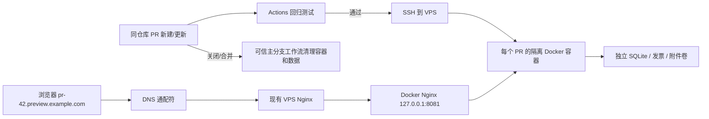

# PR 网页预览：现有 VPS + Docker + GitHub Actions

> 状态：**仓库已提供自动化代码；须先在服务器完成一次性接入**。合并 PR / 推送代码不代表预览服务已经上线。
> 此预览仅用于测试虚拟数据，**不接入生产树莓派数据库、附件、发票或账号**。

## 工作原理



推荐把预览部署在**现有云服务器 VPS**上，与树莓派上的正式 Gunicorn 应用分开；原有 FRP `10031 → 树莓派:80` 不改。VPS 现有 Nginx 增加一个通配符域名，转发到**仅绑定 127.0.0.1:8081** 的 Docker Nginx 网关。每个 PR 用独立 Docker 网络内的非 root Flask 容器、独立命名卷；关闭 PR 删除容器、路由、镜像和卷。

每次更新同一个 PR 时，先构建/启动/健康检查新容器，成功后切换代理并删除旧容器。**同一个 PR 的测试数据库跨提交保留，PR 关闭时删除**；跨版本不兼容的数据库迁移仍应新建 PR 或手动清理测试卷。

## 1. 服务器侧一次性准备

要求：Debian/Ubuntu Linux、Docker Engine、已部署且可修改配置的 Nginx、足够的内存/硬盘（单个预览容器限 768 MiB / 1 CPU，构建和网关还需要额外资源）。不要把 GitHub Actions 的预览运行在正式数据库目录。

创建**仅用于预览**的 SSH 用户和密钥。例子里的域名/IP 只是占位符：

```bash
# VPS 上
sudo adduser --disabled-password --gecos '' preview-deploy
sudo apt-get update
sudo apt-get install -y docker.io apache2-utils
sudo systemctl enable --now docker
sudo install -d -m 0750 /etc/xtyf-preview
sudo htpasswd -cB /etc/xtyf-preview/.htpasswd preview
# 会交互要求输入“访问预览网关”的密码，不要在仓库或 PR 中公开。

# 在自己的电脑上生成专用的 Actions SSH 密钥；私钥留在 GitHub Secrets
ssh-keygen -t ed25519 -f ~/.ssh/xtyf-preview-deploy -N '' -C 'xtyf-preview-actions'
# 将 ~/.ssh/xtyf-preview-deploy.pub 的内容放进 VPS 上
# /home/preview-deploy/.ssh/authorized_keys，并设置目录 700、文件 600、所有者为 preview-deploy。
```

在**可信、已检查过的仓库分支**上执行一次安装（首次测试本 PR 可使用本功能分支；后续升级应取已合并的 main）：

```bash
git clone https://github.com/SHM-white/xtyf-manager.git
cd xtyf-manager
# 只有在本功能 PR 合并前进行试运行才需要：
# git fetch origin feat/pr-preview-deployment
# git switch feat/pr-preview-deployment
sudo bash deploy/preview/setup-host.sh preview.skywalker-rm.online preview-deploy
sudo docker ps --filter name=xtyf-preview-gateway
curl -I http://127.0.0.1:8081/
# 404 正常：没有 Host 匹配的 PR 实例时默认拒绝。
```

脚本安装受信任的 `/usr/local/bin/xtyf-previewctl`、Dockerfile 和网关；给 preview-deploy 配置**仅允许执行该固定脚本的 sudo**（用户不能直接 sudo docker）。Actions 传入的是 PR 源码归档，**不会用 PR 文件覆盖服务器控制脚本或 Dockerfile**。但 Docker 构建和 PR 应用仍会执行分支代码，因此**只允许同仓库 PR 自动部署**，不要授权不可信协作者创建本仓库分支；生产敏感数据和 Docker socket 不得挂到预览容器。

容器默认测试账号为 `admin`，业务初始密码首次安装时自动随机生成、仅保存在 VPS 的 `/etc/xtyf-preview/app.env` 中。网关 HTTP Basic Auth 的账号密码与 Flask 测试账号独立；分别在服务器上维护，切勿写入公开 PR。更新密码不会自动重置已经存在的 PR SQLite 账号。

## 2. DNS + VPS Nginx

添加 DNS **A 记录**：`*.preview.skywalker-rm.online` 指向 VPS 公网 IP（不要指向树莓派）。域名也可以换为你拥有的其他后缀，须与安装参数和 GitHub 变量一致。

在 VPS 现有 Nginx 新增一个 server block，例如 `/etc/nginx/conf.d/xtyf-pr-preview.conf`：

```nginx
server {
    listen 80;
    server_name *.preview.skywalker-rm.online;

    client_max_body_size 200m;
    location / {
        proxy_pass http://127.0.0.1:8081;
        proxy_http_version 1.1;
        proxy_set_header Host $host;
        proxy_set_header X-Real-IP $remote_addr;
        proxy_set_header X-Forwarded-For $proxy_add_x_forwarded_for;
        proxy_read_timeout 120s;
        proxy_buffering off;
    }
}
```

随后 `sudo nginx -t && sudo systemctl reload nginx`。这一项与正式 `manager.*` 的 Nginx server block 相互独立，**无需更改既有 FRP 或生产端口**。网关只监听 VPS 本地回环地址，不要直接把 8081 放行到公网。

**访问安全**：当前配置保持项目既有 HTTP 部署习惯，没有额外引入 HTTPS。HTTP 不加密，Basic Auth 和 Flask 登录凭据在公网链路上可被截获。只能通过可信网络、VPN 或 Nginx IP 白名单等访问限制用于内部短期测试；如果需要任何公网环境下的登录安全，应在边界层配置 HTTPS。预览实例只使用虚拟数据和独立测试密码，绝不能导入生产备份。

## 3. GitHub Secrets 和 Variables

在仓库 Settings → Secrets and variables → Actions 设置：

| 名称 | 类型 | 值 | 必需 |
| --- | --- | --- | --- |
| `PREVIEW_SSH_HOST` | Repository secret | VPS 的 SSH 主机名 / IP | 是 |
| `PREVIEW_SSH_USER` | Repository secret | `preview-deploy` | 是 |
| `PREVIEW_SSH_KEY` | Repository secret | 电脑生成的专用 SSH **私钥完整内容** | 是 |
| `PREVIEW_SSH_KNOWN_HOSTS` | Repository secret | 已**独立核验指纹**的 SSH known_hosts 记录 | 是 |
| `PREVIEW_SSH_PORT` | Repository secret | SSH 端口，留空默认为 22 | 否 |
| `PREVIEW_BASE_DOMAIN` | Repository **variable** | `preview.skywalker-rm.online` | 是 |

`PREVIEW_SSH_KNOWN_HOSTS` 可通过 `ssh-keyscan -p 22 VPS_HOST` 获取候选主机公钥，但**必须先与 VPS 控制台上核验的 SSH host key 指纹比对**；不要将未验证的扫描结果直接视为可信值。不要把任何 SSH 私钥、frp token、测试密码或真实业务数据提交到仓库。

安装完成后检查该 SSH 用户是否能执行：

```bash
ssh -i ~/.ssh/xtyf-preview-deploy preview-deploy@VPS_HOST \
  'sudo -n /usr/local/bin/xtyf-previewctl delete 999999'
```

这里会清理虚构的 PR #999999（仅用于验证 sudo/网关连接，不能用真实 PR 编号），不会访问生产目录。

## 4. 日常使用和验证

1. 打开**同一仓库内部** PR，`PR Preview` 工作流先运行 Python/JavaScript/后端测试。失败则**不会部署**。
2. 成功后构建容器、检查 `/login`，在 PR 自动评论中更新预览入口，例如 `http://pr-42.preview.skywalker-rm.online`；Actions Summary 也会给出地址。
3. 使用网关访问密码 + Flask 虚拟 `admin` 账号登录；能看到模拟成员、组别和任务。可以在预览环境内测试资金、发票和上传，不会影响正式环境。
4. 向同一 PR 推送新 commit 时自动重新部署；**关闭或合并 PR** 时，默认分支上的 `pull_request_target` 工作流不检出 PR 代码，只调用可信控制脚本清理所有预览状态。
5. 服务器排查：`sudo docker logs xtyf-preview-gateway`、`sudo docker ps -a --filter label=xtyf.preview.pr=42`、`sudo docker exec xtyf-preview-gateway nginx -t`。Actions 失败先检查工作流日志和磁盘/内存/SSH 连通性。

若遇到不兼容迁移、数据残留，管理员可执行 `sudo /usr/local/bin/xtyf-previewctl delete 42` 清理 #42，并再次同步提交以重建；**这一操作会删除该 PR 的所有测试数据**。切勿对生产数据库运行脚本。主机 Docker 权限等价高权限，只为专用 SSH 用户启用限定 sudo，定期审核 Actions 和仓库协作者权限。

### 备用方案：预览容器放树莓派，通过现有 FRP VPS 中继

如果 VPS 没有足够资源，也可在树莓派安装同一套 Docker 网关（本地 `127.0.0.1:8081`），在**真实的** `frpc.toml` 额外新增一条固定、独立的 TCP 映射：

```toml
[[proxies]]
name = "xtyf-preview-gateway"
type = "tcp"
localIP = "127.0.0.1"
localPort = 8081
remotePort = 10032
```

随后 VPS Nginx 的 `proxy_pass` 改为 `http://127.0.0.1:10032`，保持原生产 `10031` 不动。Actions 仍需要能安全 SSH 到**部署容器的树莓派**，不建议简单公开树莓派 SSH 端口；推荐 VPN 或堡垒机。此模式比直接部署在 VPS 多出隧道和 SSH 接入步骤，故不作为默认方案。

## 限制

- 同仓库 PR 自动预览；**fork PR 不会获得 SSH Secrets，也不会自动部署**。
- 此工作流属于“部署到已有服务器”，**不会替你写入 GitHub Secrets、修改 DNS、变更线上 Nginx、登录 VPS 或启动外网服务**。
- 默认所有预览 PR 共用同一个随机初始化管理员密码（各 PR 数据库、会话密钥、发票和附件完全隔离）。业务层的密码如果在测试环境里被修改，不会反向影响其他 PR。
- 此工作流不向生产服务器部署，不会更改已有 `deploy/deploy.sh` 和 `rm-progress.service`。
